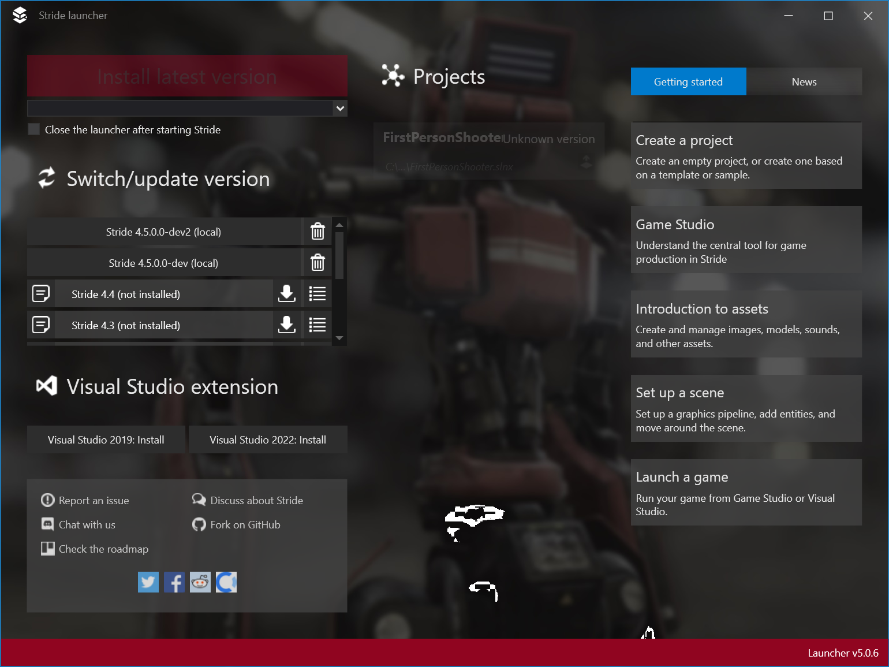
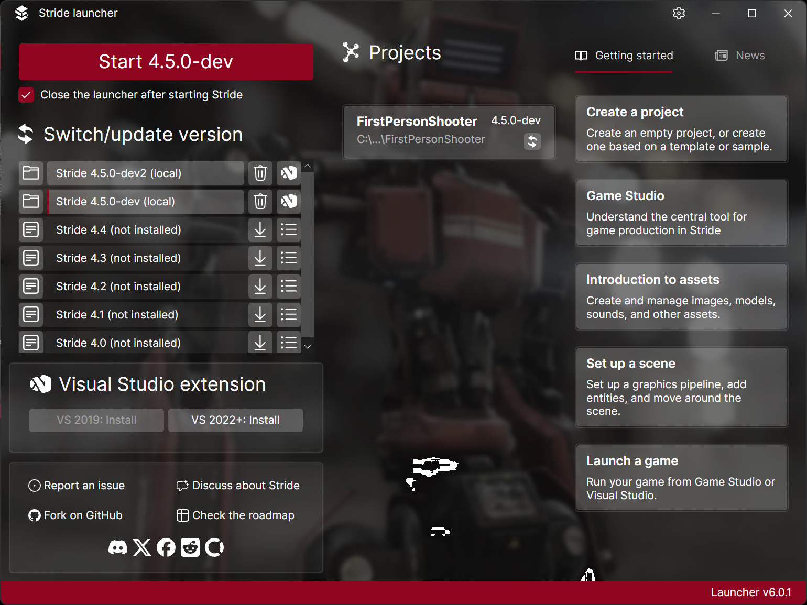
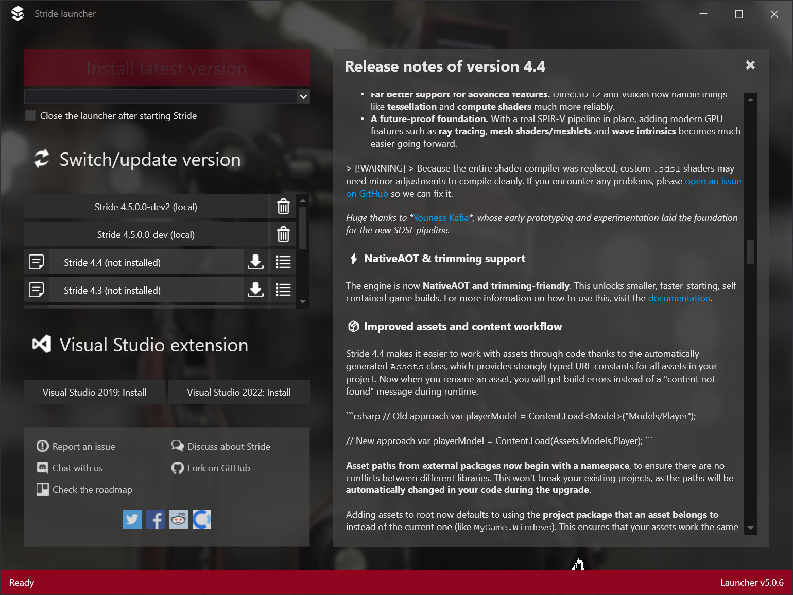
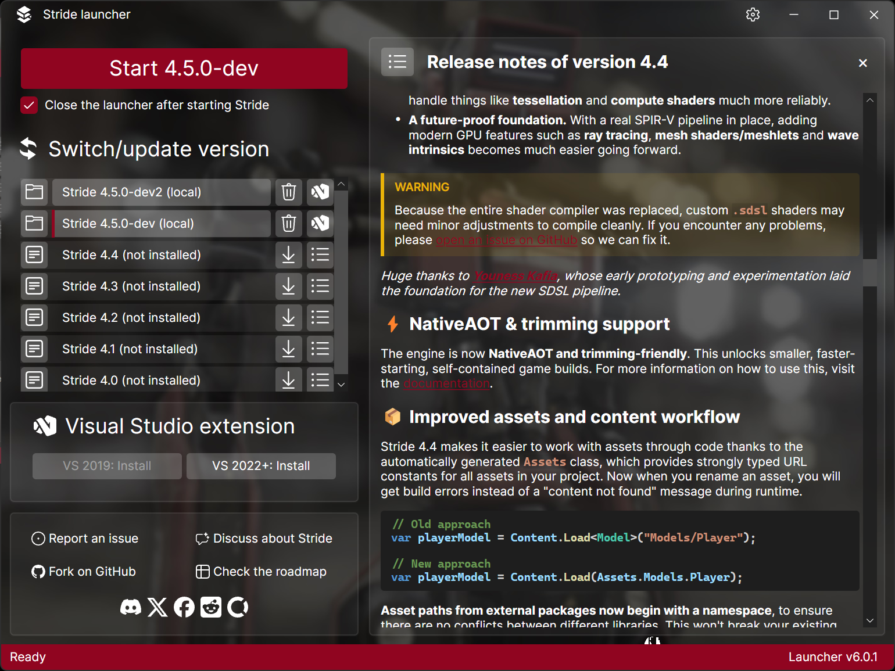
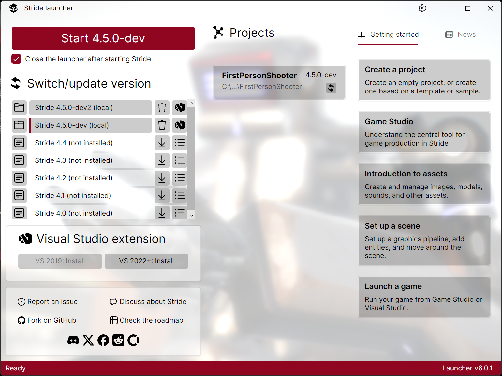
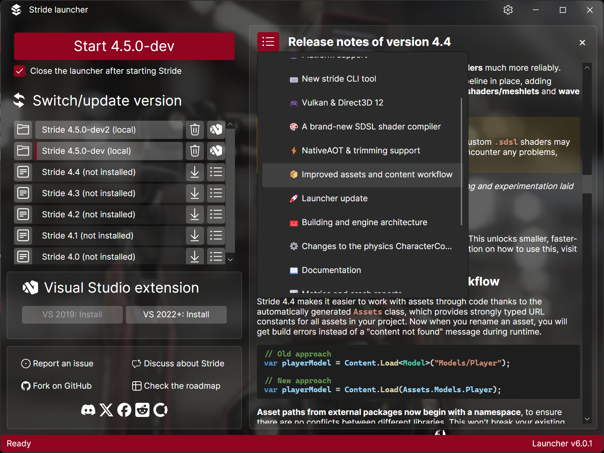
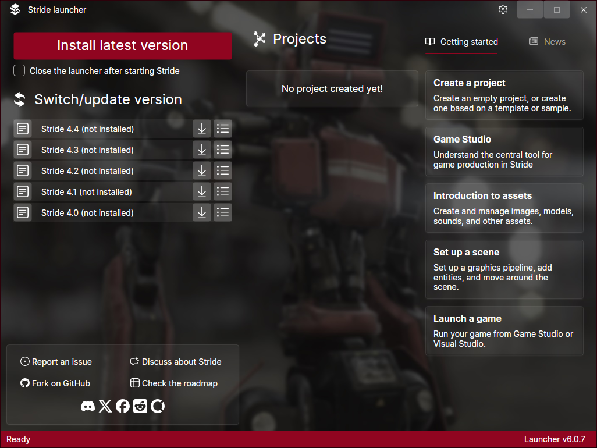

# The Door, Rebuilt: porting the Stride Launcher from WPF to Avalonia

*An entry for the Avalonia Port Challenge, by Nicolas Musset ([@Kryptos-FR](https://github.com/Kryptos-FR)).*

> **At a glance**
>
> | | |
> |---|---|
> | **Application** | [Stride Launcher](https://github.com/stride3d/stride/tree/master/sources/launcher), the first window every user of the [Stride](https://stride3d.net) game engine sees. It installs engine versions, lists recent projects, shows release notes and news, and starts Game Studio. |
> | **From → to** | WPF on .NET (`net10.0-windows`, `win-x64`) → Avalonia 12 (`net10.0`, `linux-x64` and `win-x64`) |
> | **Shipped** | [Launcher 6.0.1](https://github.com/stride3d/stride/releases/tag/launcher%2F6.0.1), 4 October 2026, to every Stride user on Windows. The previous launcher release, 5.0.6, dates from July 2022. |
> | **The port** | [stride3d/stride#3276](https://github.com/stride3d/stride/pull/3276): 57 commits, 159 files, +8,757 / −4,853 lines, merged 11 August 2026 |
> | **Built along the way** | [MarkView.Avalonia](https://github.com/Kryptos-FR/MarkView.Avalonia), a native Markdown viewer for Avalonia 12, now on NuGet |
> | **Platforms** | Windows (shipped). Linux and macOS builds below start the launcher (checked on Linux; the macOS build is untested), but managing a Stride install there is not supported yet (see [What's left](#epilogue-the-road-to-linux)). |
> | **Licence** | MIT (Stride and MarkView.Avalonia) |
> | **Category** | Best Legacy Revival |

| Launcher 5.0.6 (WPF) | Launcher 6.0.1 (Avalonia) |
|---|---|
|  |  |

## Prologue: the door everyone walks through

Before you open a scene in Stride, before you write a line of game code, you meet the launcher. It is the door to the engine. From the Xenko days until this year, that door was built in WPF, so it only ever opened on Windows.

That was fine while the rest of the house was Windows-only too. Game Studio, Stride's editor, is a large WPF application. But WPF is in maintenance mode, Linux users keep knocking, and the Stride community has spent years debating what the editor should be rebuilt on (Avalonia, MAUI, Uno). In the end it chose Avalonia, and I took the lead on the editor rewrite.

This is the story of the first piece of that rewrite to reach real users. It isn't the editor. It's the door.

## Chapter 1: an old house

The launcher has a long history. It was born at Silicon Studio, the Japanese company behind Xenko, where I worked alongside Virgile Bello (xen2), who still maintains Stride today, and Alexandre Mutel (xoofx), who would later write [Markdig](https://github.com/xoofx/markdig). Xenko went open source, was renamed Stride, and the launcher came along, collecting habits from every era:

- a Windows mutex and `Process.GetProcessesByName` to stop two instances running at once;
- a Win32 window handle, passed on the command line so Game Studio could close the launcher with a `WM_CLOSE` message;
- a registry check for .NET Framework 4.7.2 and a prerequisites installer;
- a telemetry client wrapped around every download, with a privacy-policy consent dialog to go with it;
- compatibility code for Xenko packages, Xenko executables and Stride ≤ 3.0 environment variables;
- and, in the release-notes panel, a Markdown renderer I had written myself, back in 2015.

That last one comes back later.

## Chapter 2: the editor that stalled, and the smaller door

The launcher wasn't where this started. I started with Game Studio.

Every Stride WPF tool sits on a shared presentation layer, `Stride.Core.Presentation`: view-model base classes, commands, dialogs, converters, behaviours and markup extensions. So the first job was splitting it. In December 2023, on the `xplat-editor` branch, the WPF-specific half became `Stride.Core.Presentation.Wpf`. Everything that didn't depend on WPF stayed in a UI-agnostic `Stride.Core.Presentation`, and a new `Stride.Core.Presentation.Avalonia` began as its Avalonia twin. The UI-agnostic split landed on master in January 2024 as [#2082](https://github.com/stride3d/stride/pull/2082) ("Make Stride.Core.Presentation cross-platform", 521 files touched), so the WPF editor and the future Avalonia one could share their view models from then on. Not all of them yet: some WPF view models still carry Windows-specific code that needs refactoring. But sharing the view-model logic is one of the big advantages of this approach, and one of the reasons we chose Avalonia.

On 8 January 2024 the launcher got its first Avalonia version on that branch: 156 files changed, 2,260 lines added and 9,525 removed. Then came more groundwork: modernising the code ([#2658](https://github.com/stride3d/stride/pull/2658)), moving to newer .NET versions, a [cross-platform editor prototype](https://github.com/stride3d/stride/pull/2034), and, in May 2025, a commit with a very satisfying title: "[Launcher] Make the build work on Linux".

But Game Studio is huge, and the editor port started to stall. A rewrite that never ships helps nobody, so I narrowed the scope to something users could actually have: the launcher. In April 2026 I cherry-picked the Avalonia launcher off the editor branch onto master, together with the minimum of `Stride.Core.Presentation.Avalonia` it needed, and upgraded it to Avalonia 12 the same day. That branch became [#3276](https://github.com/stride3d/stride/pull/3276).

## Chapter 3: what translated, and what didn't

### Most of it carried over

The view models came across almost unchanged. They already sat on the UI-agnostic presentation layer from [#2082](https://github.com/stride3d/stride/pull/2082), so `MainViewModel`, `StrideVersionViewModel` and their friends didn't care what was drawing them. NuGet-based version management (`NugetStore`) is plain .NET and came along as is. Most XAML was mechanical: `.xaml` became `.axaml`, `Visibility` became `IsVisible`, `ToolTip` became `ToolTip.Tip`, and bindings gained `x:DataType` so Avalonia's compiled bindings could check them at build time.

### The markup extensions were the real work

Stride's XAML leans heavily on inline markup extensions, especially inside bindings. This is the WPF update button from the 5.x launcher:

```xml
<Button Visibility="{sskk:MultiBinding {Binding CanBeDownloaded}, {Binding CanDelete},
                     Converter={sskk:MultiChained {sskk:AndMultiConverter}, {sskk:VisibleOrCollapsed}}}" />
```

And this is the Avalonia version in 6.0.1:

```xml
<Button IsVisible="{sd:MultiBinding {Binding CanBeDownloaded}, {Binding CanDelete}, Converter={sd:AndMulti}}" />
```

Avalonia's built-in `MultiBinding` is element syntax only, so writing it inline like this meant porting Stride's `MultiBinding` markup extension. The same goes for the chained converters, and for the small typed values that make converter parameters readable:

```xml
IsVisible="{Binding ActiveVersion?.AvailableEditors.Count,
            Converter={sd:Chained {sd:IsGreater}, Parameter1={sd:Double 1}},
            FallbackValue={x:False}, TargetNullValue={x:False}}"
```

Some extensions disappeared along the way: Avalonia's `IsVisible` is a boolean, so the `VisibleOrCollapsed` converter wasn't needed any more. Others needed rethinking. In WPF, the `Localize` extension works both as a value and as a converter inside a binding. In Avalonia it had to be split into two, a `LocalizeString` markup extension for plain values and a `Localize` converter for bindings. The launcher doesn't use it, but Game Studio's Avalonia rewrite uses it everywhere.

### Windows-only habits needed a cross-platform answer

The table in the port's [`port-status.md`](https://github.com/stride3d/stride/blob/master/docs/launcher/port-status.md) exists so that reviewers wouldn't "fix" these back:

| Area | WPF launcher | Avalonia launcher |
|---|---|---|
| Single instance | Windows mutex + process scan | `FileLock` in the user's temp path |
| Entry point | `[STAThread] Main`, WPF `ShutdownMode` | Avalonia classic desktop lifetime |
| Launcher ↔ Game Studio | Win32 `WM_CLOSE` to an HWND | HWND on Windows (via `TryGetPlatformHandle()`), a named pipe elsewhere |
| *Show in Explorer* | `explorer.exe /select` | Explorer, `open -R` on macOS, DBus `FileManager1.ShowItems` on Linux with an `xdg-open` fallback |
| Settings | Windows paths | `%LocalAppData%`, `$XDG_DATA_HOME`, `~/Library/Application Support` through one `EditorPath` helper |
| Telemetry and consent | `Stride.Metrics` + privacy dialog | Removed, permanently. Stride no longer collects telemetry. |
| Xenko compatibility | Xenko packages, executables, env vars | Removed: Xenko is end of life |

The IPC is a good example of the approach. Nothing is rewritten for the sake of it: Windows keeps the HWND message Game Studio already understands, and the other platforms get a `NamedPipeServerStream` that waits for Game Studio to connect and send one byte once its main window has loaded.

### Small surprises

- **A right-click that missed.** On Linux, right-clicking a recent project opened its context menu in the wrong place, because the event didn't reliably bubble from the row's button to the outer `Border` that owned the menu. Moving the `ContextMenu` onto the `Button` itself fixed it.
- **A self-updater that tried to run an .exe on Linux.** The force-reinstall check downloaded `StrideSetup.exe` and then crashed at `Process.Start`. It now only runs on Windows.
- **Animations as classes.** Avalonia has no equivalent of WPF storyboards, so they became style classes: the release-notes and announcement panels toggle `Classes.visible` and slide in with a `TransformOperationsTransition`, inside a `ClipToBounds` root so they really are hidden while off screen.
- **Versioning assumptions.** `Avalonia.Controls.DataGrid` doesn't follow Avalonia's main version numbers, so pinning it to "the same version as Avalonia" in central package management broke.
- **Fewer dependencies.** The test runner dropped CommunityToolkit.Mvvm for Stride's own `ViewModelBase`, which meant renaming `SetProperty` to `SetValue`.

## Chapter 4: the missing page

Every launcher has a release-notes panel, and Stride's renders Markdown straight from the documentation site. In the WPF launcher, that panel looked like this:

```xml
<!-- BaseUrl must be set before Text so when ActiveReleaseNotes is updated, the binding of ImageBaseUrl
     is updated first, then MarkdownContent is updated and the text converted,
     we will have a valid path for relative urls -->
<sskk:MarkdownTextBlock BaseUrl="{Binding ActiveReleaseNotes.BaseUrl, Mode=OneWay}"
                        Text="{Binding ActiveReleaseNotes.MarkdownContent}" ... />
```

Behind `MarkdownTextBlock` was `XamlMarkdown.cs`: 1,037 lines of regular expressions turning Markdown into a WPF `FlowDocument`. Its licence header reads *"Modified version copyright (c) 2015 Nicolas Musset"*, on top of Bevan Arps's 2010 Markdown.XAML. I had forgotten I'd written it. Being regex-based, it choked on newer Markdown syntax, which is why the release notes sometimes rendered badly.

Avalonia has no `FlowDocument`. The Avalonia 11 version of the launcher used an existing community control, Markdown.Avalonia.Tight. Avalonia 12 arrived when most of the launcher port was already done, and that control wasn't ready for it. It was also missing features, and it didn't use Markdig under the hood. I needed a renderer that was native to Avalonia 12, built on Markdig, and able to handle the rest of what Stride's documentation contains: code blocks, tables, Mermaid diagrams, SVG badges.

I had been here before. In 2016 I started [Markdig.Wpf](https://github.com/Kryptos-FR/markdig.wpf), a Markdig renderer for WPF, meant for a future WPF launcher (and written partly for fun, because I liked Markdig). In June 2017 it got a big contribution from Steven Kirk ([@grokys](https://github.com/grokys)), the founder of Avalonia: four pull requests that fleshed out the WPF renderer (lists, emphasis, code, links, images, task lists), merged the projects, added tables, and added the `MarkdownViewer` control ([#3](https://github.com/Kryptos-FR/markdig.wpf/pull/3), [#4](https://github.com/Kryptos-FR/markdig.wpf/pull/4), [#5](https://github.com/Kryptos-FR/markdig.wpf/pull/5), [#6](https://github.com/Kryptos-FR/markdig.wpf/pull/6)). Once the launcher moved to Avalonia, Markdig.Wpf had no user left to serve, and I archived it in March 2024.

So in April 2026 I took the archived Markdig.Wpf off the shelf and used it as the base for a native Avalonia renderer, keeping the name grokys had given the control nine years earlier. MarkView.Avalonia's `MarkdownViewer` replaced Markdown.Avalonia in the launcher on 17 May 2026, and today the release-notes panel reads:

```xml
<mv:MarkdownViewer Markdown="{Binding ActiveReleaseNotes?.MarkdownContent}"
                   BaseUri="{Binding ActiveReleaseNotes?.BaseUrl}" />
```

There's no ordering comment any more, because the viewer resolves relative links and images against `BaseUri` whenever either property changes. The launcher also gained an outline button to jump between headings ([#3372](https://github.com/stride3d/stride/pull/3372)), and the 6.0.1 release notes describe the result as "a more modern renderer with support for new syntax that previously caused problems".

The same section of the Stride 4.4 release notes in both launchers. The regex-based renderer runs the C# code block into the text and prints the `[!WARNING]` marker as is. MarkView renders the alert and the syntax-highlighted code block.

| Launcher 5.0.6 (WPF, `XamlMarkdown`) | Launcher 6.0.1 (Avalonia, MarkView) |
|---|---|
|  |  |

## Chapter 5: building MarkView without a FlowDocument

A WPF `FlowDocument` gives you a lot for free: one text flow, selection across paragraphs, find, printing. Avalonia gives you excellent building blocks (`TextBlock` with inlines, panels, styles, control themes) and asks you to assemble the rest. MarkView turns Markdig's syntax tree into ordinary Avalonia controls, so the parts that took longest were the ones a `FlowDocument` would have handled:

- **Selection across a forest of `TextBlock`s.** Dragging from a heading through a table into a code block has to feel like one document. MarkView doesn't use each `TextBlock`'s own selection. A transparent overlay owns selection for the whole document, maps the pointer to text positions in every block, and copies a text equivalent for images, formulas and diagrams.
- **Theme switches that keep your place.** Switching light and dark recolours syntax-highlighted code in place (each line is tokenised once with both palettes), re-renders Mermaid and LaTeX images, and doesn't reset the scroll position. On WebAssembly, profiling cut a theme switch from about 870 ms to about 150 ms.
- **Mermaid and LaTeX without a browser.** Diagrams go through the pure .NET Mermaider library and formulas through CSharpMath on SkiaSharp, so nothing needs a WebView, and both work on Linux and in the browser.
- **Lazy rendering.** Images, formulas, diagrams and code colours are only built when they get near the viewport. One lesson here for anyone doing the same: Avalonia clips the effective viewport to each clipping ancestor, and a `TextBlock` clips, so an inline image would never think it was visible until its whole paragraph was.
- **Things Avalonia mirrors for you.** In right-to-left text Avalonia mirrors a visual with a render transform, so overlays must map bounds with `TransformToVisual`, never by adding `Bounds` offsets.
- **Links that can take focus.** Links are `Span`s, which can't take keyboard focus or have automation peers, so a second overlay hosts one focusable target per link for Tab navigation and screen readers.
- **Streaming.** For AI chat apps the viewer can append text and only re-render the blocks still open. On the 2,000-line README test, a full stream went from 31 s and 5.6 GB allocated to 2.5 s and 480 MB.

Along the way I filed upstream issues where I hit framework bugs (for example [AvaloniaUI/Avalonia#22505](https://github.com/AvaloniaUI/Avalonia/issues/22505) on runtime style changes and [#22530](https://github.com/AvaloniaUI/Avalonia/issues/22530) on right-to-left hit testing), with workarounds in MarkView until they are fixed.

MarkView now has about 17,600 lines of library code and 37,600 lines of tests (around 2,000 tests, most of them headless Avalonia tests, with mutation testing in CI), a [documentation site](https://kryptos-fr.github.io/MarkView.Avalonia/), and a browser demo built from the same code as the desktop one.

### What came next: MarkView 12.4.0

The launcher still ships MarkView 12.2.1. The library kept going after the launcher shipped, and [12.4.0](https://github.com/Kryptos-FR/MarkView.Avalonia/releases/tag/v12.4.0), released on 21 October 2026, is the biggest update so far:

- **Streaming for AI chat.** `BeginStreaming()` appends text from any thread and re-renders only the blocks that can still change. Unfinished syntax such as `**bold` renders as it will once complete, and the scroll position, selection and focus survive every update.
- **Faster long documents.** On a document of 100 sections, each with a code block and formulas, the first frame drops from about 3.7 s to 0.6 s, a theme switch from 1.3 s to 0.3 s, and memory from 270 MB to 85 MB.
- **Three theme presets.** GitHub, Chat and Docs, each in light and dark, all switching live and meeting WCAG AA contrast.
- **Reading tools.** A code block toolbar with copy buttons and line numbers, find in document, foldable alerts, headings and `<details>`, and a context menu that copies as Markdown or HTML and saves images and diagrams.
- **Accessible and international.** Screen readers hear every block with its role, Tab walks through links in reading order, a high-contrast mode follows the system, and Hebrew and Arabic read right to left.
- **GitHub-flavoured by default.** A viewer without a pipeline now renders Markdown the way GitHub does, including a safe subset of HTML mapped to native controls.

Moving the launcher to 12.4.0 would bring find, folding and screen-reader support to its release notes. It would also fix something you can see in the comparison in Chapter 4: in 12.2.1, links take the app's accent colour as is, so in the launcher they are Stride red on a dark panel and hard to read. 12.4.0 uses a lighter shade of the accent in dark themes, chosen to keep 4.5:1 contrast whatever the accent.

## Chapter 6: the long pull request

[#3276](https://github.com/stride3d/stride/pull/3276) opened on 21 April 2026 and was itself a do-over: it recreated an earlier PR, [#3027](https://github.com/stride3d/stride/pull/3027), after a history rewrite. Within four days it had its own documentation set under [`docs/launcher/`](https://github.com/stride3d/stride/tree/master/docs/launcher), covering settings, localisation, packaging, lifecycle, views, view models and cross-platform notes. It also had a `port-status.md` roadmap whose phases got struck through as they closed: window lifecycle parity, cross-platform services, slide animations, view-model tests with Avalonia headless.

Then it waited. The branch absorbed master four times between May and August, while the old WPF launcher stayed the release candidate in case an emergency fix was needed. xen2 merged it on 11 August, apologising for "dragging it so long". My merge comment left one issue to double-check ([#3290](https://github.com/stride3d/stride/issues/3290)) and "a few visual artifacts" to clean up afterwards.

## Chapter 7: shipping day

Launcher 6.0.1 went out on 4 October 2026. It looks familiar on purpose: dark by default again, with the red accent of the 5.x launcher. Underneath, everything is new.

Shipping it took more than my port, and the release is better for it:

- **xen2** (Virgile Bello) merged the port and built most of what went around it. For 6.0.1: the settings gear with theme switching and opt-in pre-release updates ([#3500](https://github.com/stride3d/stride/pull/3500)), version rows that open and remove local builds ([#3506](https://github.com/stride3d/stride/pull/3506)), real install and uninstall progress ([#3507](https://github.com/stride3d/stride/pull/3507)), recent projects that open with the right version ([#3509](https://github.com/stride3d/stride/pull/3509)), and the installer clean-up. After 6.0.1 he kept shipping, with six more releases (6.0.2 to 6.0.7) in under two weeks: nightly builds with their own badge, a quiet uninstall that works with winget, self-updates streamed to disk, and recent projects that read their Stride version from a `.csproj`.
- **xen2** also wrote the `stride` command-line tool ([#3240](https://github.com/stride3d/stride/pull/3240), June 2026), which installs Stride versions, creates projects and updates itself from any terminal. It shares its version-management core with the launcher, and it's what makes Stride usable on Linux today while the launcher's Linux installs are still untested.
- **Jklawreszuk** (Jakub Ławreszuk) did the Fluent 2 visual refresh ([#3383](https://github.com/stride3d/stride/pull/3383): custom title bar, new icons, accent buttons, unified status bar, rounded cards) and kept polishing the cards after the release ([#3527](https://github.com/stride3d/stride/pull/3527)). He also removed the telemetry system ([#3279](https://github.com/stride3d/stride/pull/3279)) and contributed groundwork along the way.
- **ferafiks** polished the experimental light mode ([#3502](https://github.com/stride3d/stride/pull/3502)) and fixed the recent-projects context menu ([#3483](https://github.com/stride3d/stride/pull/3483)), and **minktusk** made the brand icons ([#2345](https://github.com/stride3d/stride/pull/2345)).

This entry covers my part: the port itself ([#3276](https://github.com/stride3d/stride/pull/3276)), the release-notes improvements ([#3372](https://github.com/stride3d/stride/pull/3372)), the presentation-layer groundwork, and MarkView.Avalonia.

| Light theme | Release notes with the outline open |
|---|---|
|  |  |

## What it cost

The honest answer is that I don't know exactly, in hours. The cross-platform effort began with a single commit on 16 December 2023, and since then the rhythm has been anything but regular: some months I worked every evening and every weekend, others not at all. Added up, the whole cross-platform effort is likely several months of full-time work. The launcher's share of that is probably three to four months, most of it in the Avalonia 11 years on the editor branch.

The final stretch is easier to measure. The [#3276](https://github.com/stride3d/stride/pull/3276) branch has commits on 14 separate days between 21 April and 10 August 2026. At two to three hours an evening, that's roughly 30 to 40 hours to take the launcher from the editor branch to a mergeable port on Avalonia 12. That figure is a floor: it leaves out the evenings spent testing and reading code that never produced a commit.

The launcher port itself wasn't funded. In late 2025, Stride's [Open Collective](https://opencollective.com/stride3d/projects/editor-rewrite-avalonia) paid me $4,000 for the cross-platform effort as a whole, covering everything since that first commit. Set against several months of work, it was recognition rather than a salary.

What I can measure:

| | |
|---|---|
| First cross-platform commit | 16 December 2023 (`xplat-editor` branch) |
| First Avalonia launcher | 8 January 2024 (`xplat-editor` branch) |
| Presentation-layer split on master | [#2082](https://github.com/stride3d/stride/pull/2082), 17 January 2024, 521 files |
| The port PR | [#3276](https://github.com/stride3d/stride/pull/3276): 57 commits over 16 weeks (21 April → 10 August 2026), 159 files, +8,757 / −4,853 |
| Active days on [#3276](https://github.com/stride3d/stride/pull/3276) | 14 days with commits, about 30–40 hours at 2–3 hours a day |
| Launcher files | 35 → 43 C# files, 4 XAML → 7 AXAML views, 24 → 3 PNG images |
| MarkView.Avalonia | 199 commits from 8 April to 21 October 2026, 9 stable releases on NuGet (12.0.1 → 12.4.0), ~17.6k lines of code, ~37.6k lines of tests |
| Contributors to 6.0.1 | 5 (see above) |

**AI assistance.** The challenge says AI-assisted code is fine, but I'd rather say plainly where I used it than leave readers guessing. The two halves of this story were built in different eras.

The launcher side mostly predates any AI tool: the split of `Stride.Core.Presentation`, the whole of `Stride.Core.Presentation.Avalonia`, and nearly all of the launcher port were written by hand. Some of the last commits on [#3276](https://github.com/stride3d/stride/pull/3276) probably had an assistant involved, though I couldn't say exactly which ones, and even then I kept working on them locally before pushing. So it's mixed at the very end, and nothing like the MarkView story that follows.

MarkView.Avalonia is the other half, and it was made with a lot of help from AI. It didn't start from a blank page, though: Markdig.Wpf, itself written long before any AI was involved, gave it a solid base to port from. For 12.4.0 the way of working changed again. I worked with Claude through its Projects feature: I wrote the specs, prepared the plans and set the direction, the agent wrote the code, and I did the final review, challenging the implementation until it was right. The repository's `CLAUDE.md` is part of that story, and it's there for anyone to read.

The same goes for this write-up: I wrote it with AI assistance, from my notes, the git history and the pull requests.

## Epilogue: the road to Linux

The launcher builds on Windows, Linux and macOS today, from one codebase. On Linux it starts, lists the Stride versions from NuGet and runs the whole UI (screenshot below, taken on Linux under WSL from the 6.0.7 tag). [Builds for each platform](https://github.com/Kryptos-FR/stride/releases/tag/challenge-2026-builds) are attached to this entry. But I'd rather be honest about what that means:



- **Windows** is the shipped, supported platform.
- **Linux** runs the launcher, but installing Stride versions through it is untested there, and Game Studio itself is still WPF and Windows-only (it partly works under Wine/Proton). For now, Linux users have xen2's `stride` CLI, which does the same version management from a terminal.
- **macOS** needs a RID, an `.app` bundle, codesigning and notarisation, and a review of the window chrome before it's more than a demo.
- Moving to MarkView 12.4.0 is the next easy win for the release-notes panel (see [What came next](#what-came-next-markview-1240)).
- Still open from `port-status.md`: a friendly message when the .NET runtime is missing on Windows, a Linux path for reinstall-based self-updates, headless integration tests of the real window, and remembering the selected patch version.

The launcher was always the small door. Game Studio's Avalonia rewrite is the big one, and it now builds on everything the launcher proved out: the presentation layer, the markup extensions, the per-OS IPC, and a Markdown viewer the whole Avalonia ecosystem can use.

### If you're porting a WPF app with rich content

1. **Split the UI-agnostic layer first, on master.** Getting the view models off WPF while the WPF app kept shipping was the single most useful step. It made the port a UI rewrite, not an application rewrite.
2. **Port your markup extensions early.** If your XAML is full of inline converters and multi-bindings, that vocabulary is the real migration surface. Plan to split extensions that WPF lets you use both as a value and as a converter.
3. **Shrink the scope until it ships.** A smaller application that reaches users teaches more than a large one stuck on a branch.
4. **Write down the deliberate differences.** A `port-status.md` with a "don't revert this" table saved review time and a few accidental regressions.
5. **There's no `FlowDocument`, and that's fine.** Rich text in Avalonia is a tree of real controls. You can do more with it (lazy rendering, live theming, accessibility overlays), but selection, find and focus become your job.

## Links

- Port: [stride3d/stride#3276](https://github.com/stride3d/stride/pull/3276) · enhancements [#3372](https://github.com/stride3d/stride/pull/3372) · groundwork [#2082](https://github.com/stride3d/stride/pull/2082), [#2658](https://github.com/stride3d/stride/pull/2658), [#2783](https://github.com/stride3d/stride/pull/2783)
- Release: [launcher 6.0.1](https://github.com/stride3d/stride/releases/tag/launcher%2F6.0.1)
- Launcher docs: [docs/launcher/](https://github.com/stride3d/stride/tree/master/docs/launcher)
- MarkView.Avalonia: [repository](https://github.com/Kryptos-FR/MarkView.Avalonia) · [NuGet](https://www.nuget.org/packages/MarkView.Avalonia)
- Markdig.Wpf (archived): [repository](https://github.com/Kryptos-FR/markdig.wpf)
- Builds: [launcher 6.0.7 for Windows, Linux and macOS](https://github.com/Kryptos-FR/stride/releases/tag/challenge-2026-builds)
